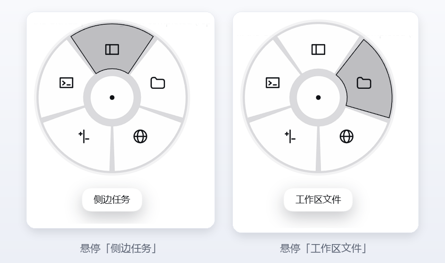

# dsh-radial-menu

Qoder 风格的环形（放射状）右键菜单 —— 给 [DeepSeek Harness](https://github.com/deepseek-ai) 桌面版用的插件。

在会话区域右键，光标周围展开一圈图标：工作区文件、内置浏览器、审阅、终端、侧边任务；圆环下方一条胶囊框显示当前指向的项。左侧工作区、右侧面板和窗口其他区域保留原本的右键行为。每一项都打开应用已有的面板，设置里可以自选显示哪些、顺序和触发方式。



## 安装

### 从本地目录

```bash
dsh plugin --profile desktop add /path/to/dsh-radial-menu
```

或打开 设置 → 插件 → Add plugin，选择本目录。

### 从 GitHub

```bash
dsh plugin --profile desktop add github:niaokupifa/dsh-radial-menu
```

装好后在「设置 → 环形菜单」里调整。

## 使用

| 操作 | 结果 |
| --- | --- |
| 右键 | 展开圆环 |
| 移动鼠标 | 高亮所在扇区，下方胶囊框显示名称 |
| 单击扇区 | 执行并关闭 |
| 单击中心 / Esc / 点空白处 / 滚动 | 关闭 |
| Shift + 右键 | 保留系统菜单 |

输入框、可编辑区域和选中文字上的右键始终交给系统菜单，避免打断复制粘贴。

## 可配置项

- **触发方式**：右键（默认）、Alt + 右键、Ctrl + 右键、关闭
- **圆环大小**：小 / 中 / 大
- **菜单项**：勾选显示哪些，↑ ↓ 调整顺序，可恢复默认

配置存于本机 `localStorage` 的 `dsh-radial-menu.config.v1`。

## 实现

- `index.js`：宿主半边（空），只为让 bundle 补丁有落点。
- `client.js`：浏览器半边。一个 `shell.overlay` 条目负责圆环（全局捕获 `contextmenu`），一个 `settings.section` 条目负责设置页；所有文案走 `ctx.locale`，样式只用 `--dsw-alias-*` 主题变量。
- `cordis.patch.yml`：把插件插入 desktop profile。

要求：`dsh.client.inject` 里列出的三个客户端包（layout / sidebar-right / settings）是 DSH 自带的，无需额外安装。

## 开发

无构建步骤，也没有依赖。改完 `client.js` 后在插件列表里重载（或重开窗口）即可。

```bash
node --check client.js   # 语法自检
```

## 已知限制

- 「审阅」只能聚焦已经打开的审阅页（全局覆盖层拿不到当前回合的地址），否则给出提示。
- 「侧边任务」没有对应的右侧栏页面，映射为切换左侧栏。
- 仅在 DSH 桌面版验证；Web 版浏览器面板默认关闭。

## 许可

MIT
