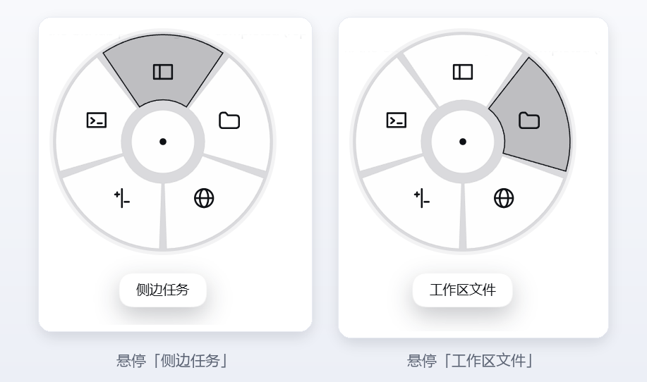

# 环形右键菜单

在 DeepSeek Harness 里按下右键，光标周围展开一圈快捷入口 —— 不用再在长长的列表菜单里找。



## 它做什么

- 在会话区域右键，五个图标环绕光标排布，鼠标划过即高亮；圆环下方一条胶囊框显示当前项的名字，未悬停时显示「选择一个操作」。左侧工作区、右侧面板与窗口其他区域不拦截右键。
- 每项直接打开应用已有的界面，不会另造一份：

  | 入口 | 行为 |
  | --- | --- |
  | 工作区文件 | 聚焦右侧栏的文件页（`sidebarRight.openTab('files')`） |
  | 内置浏览器 | 打开右侧栏浏览器页（`sidebarRight.openTab('browser')`） |
  | 审阅 | 聚焦本会话已打开的审阅页；没有时提示从会话末尾的改动卡片进入 |
  | 终端 | 打开右侧栏终端页（`sidebarRight.openTab('terminal')`） |
  | 侧边任务 | 切换左侧栏（`layout.toggleSidebar()`） |

- 设置里可以自选显示哪几项、它们的顺序、圆环大小和触发方式（右键 / Alt+右键 / Ctrl+右键 / 关闭）。选择立刻生效，存在本机。

## 会保留系统菜单的情况

- 按住 `Shift` 再右键；
- 在输入框、文本域、可编辑区域上右键；
- 有选中的文字时右键。

这样复制、粘贴、拼写检查等系统能力不会被打断。

## 边界

- 「审阅」需要一个可寻址的改动回合（`dsh-resource://changes-review/session/<session>/<seq>/<turn>`）。环形菜单是全局覆盖层，拿不到当前回合的坐标，所以它只负责把已经打开的审阅页调到前台，否则给出提示。
- 「侧边任务」目前没有独立的右侧栏页面（后台任务列表在会话头部），因此映射为切换左侧栏。
- 只在 DeepSeek Harness 桌面版（profile `desktop`）验证；Web 版里右侧栏浏览器默认关闭，需要时在 profile patch 中启用 `ui-sidebar-browser`。

## 配置

切换内容保存在本机 `localStorage` 的 `dsh-radial-menu.config.v1`：

```json
{
  "trigger": "context",
  "size": "medium",
  "items": ["files", "browser", "review", "terminal", "sidebar"]
}
```

恢复默认按钮会写回初始值。
